# ARQUITECTURA DE BASE DE DATOS POSTGRESQL - NEUROSYNC LABS

**Proyecto:** NeuroSync Labs (Plataforma de Optimización Cognitiva y Biofeedback BCI)  
**Motor:** PostgreSQL 15+ / 16+  
**Archivos asociados:**
* `schema.sql`: Definición de DDL, tablas, enums, triggers automáticos y vistas analíticas.
* `seed.sql`: Datos semilla realistas para pruebas del embudo, telemetría y dashboard.

---

## 1. Diagrama Entidad - Relación (ERD)

```mermaid
erDiagram
    BETA_WAITLIST ||--o| USER_PROFILES : "se convierte en"
    USER_PROFILES ||--o{ TRAINING_SESSIONS : "realiza"
    TRAINING_SESSIONS ||--o{ TELEMETRY_SNAPSHOTS : "genera telemetría"
    CONTACT_MESSAGES }|..o| BETA_WAITLIST : "prospectos e inversores"

    BETA_WAITLIST {
        uuid id PK
        varchar email UK
        varchar full_name
        user_role role
        varchar institution_or_company
        text use_case
        int priority_score
        uuid access_token UK
        access_status status
        timestamptz created_at
    }

    USER_PROFILES {
        uuid id PK
        uuid waitlist_id FK
        varchar email UK
        varchar full_name
        varchar paired_hardware_model
        numeric cognitive_baseline_score
        numeric current_cognitive_score
        int total_focus_minutes
        int streak_days
        timestamptz last_session_at
    }

    TRAINING_SESSIONS {
        uuid id PK
        uuid user_id FK
        varchar session_title
        timestamptz started_at
        timestamptz ended_at
        int duration_seconds
        numeric initial_focus_score
        numeric final_focus_score
        numeric improvement_percentage
        numeric avg_alpha_hz
        numeric avg_beta_hz
        numeric avg_gamma_hz
        numeric avg_latency_ms
        session_state status
    }

    TELEMETRY_SNAPSHOTS {
        bigserial id PK
        uuid session_id FK
        timestamptz recorded_at
        numeric alpha_power
        numeric beta_power
        numeric gamma_power
        numeric theta_power
        numeric focus_index
        numeric fatigue_index
        int latency_ms
    }

    CONTACT_MESSAGES {
        uuid id PK
        varchar full_name
        varchar email
        varchar interest_area
        text message
        boolean is_high_priority_investor
        boolean telegram_dispatched
        message_status status
        timestamptz created_at
    }
```



---

## 2. Los 3 Pilares Implementados en la Base de Datos

### Pilar 1: El Embudo de Acceso Exclusivo (La Waitlist Inteligente)
* **Tabla `beta_waitlist`**: Almacena a los aspirantes a la beta privada.
* **Algoritmo de Priorización Automatizado (Trigger `trg_waitlist_scoring_before_insert`)**:
  * Inversores reciben **100 puntos** base.
  * Investigadores reciben **85 puntos** base.
  * Desarrolladores reciben **75 puntos** base.
  * Biohackers reciben **65 puntos** base.
  * Bonificación de **+10 puntos** adicionales si declaran institución o empresa.
  * Si el aspirante alcanza **>= 80 puntos**, el trigger lo promueve automáticamente a estado `PRIORITARIO`.
* **Llave Criptográfica (`access_token`)**:
  * Cada registro genera un `gen_random_uuid()` único e irrepetible.
  * Este token se incluye en el enlace de invitación enviado por correo (`https://neurosynclabs.tech/beta/join?token={access_token}`).

---

### Pilar 2: El Simulador y Motor de Telemetría en Tiempo Real
* **Tabla `telemetry_snapshots`**:
  * Diseñada para almacenar streams de alta frecuencia (20 Hz a 100 Hz).
  * Bandas de frecuencia EEG:
    * **Alpha (8-12 Hz):** Relajación alerta y foco pasivo.
    * **Beta (13-30 Hz):** Concentración activa y resolución de problemas.
    * **Gamma (30-100 Hz):** Alta plasticidad cognitiva y asimilación rápida de ideas.
    * **Theta (4-8 Hz):** Detección de somnolencia y fatiga mental.
  * Indicadores de **Latencia (`latency_ms`)**: Comprueba que la latencia se mantenga bajo el umbral de **$< 15\text{ms}$**.

---

### Pilar 3: El Panel de Control y Métricas del Usuario (Dashboard)
* **Tabla `user_profiles` y `training_sessions`**:
  * Registro de calibración base (`cognitive_baseline_score`) vs rendimiento actual (`current_cognitive_score`).
  * **Cálculo de Mejora Automático (`improvement_percentage`)**: Columna generada que calcula matemáticamente el porcentaje de optimización obtenido (validando el reclamo del **+42%**).
  * **Trigger `trg_session_finished_update_profile`**: Al marcarse una sesión como `COMPLETADA`, suma automáticamente los minutos de foco al perfil del usuario sin necesidad de consultas manuales.
* **Tabla `contact_messages`**:
  * Guarda las solicitudes institucionales.
  * **Trigger `trg_contact_investor_check`**: Detecta automáticamente palabras clave de inversión (`capital`, `inversión`, `seed`, `venture`) y marca la bandera `is_high_priority_investor = TRUE` para disparar una notificación inmediata al equipo fundador (Telegram / Webhook).

---

## 3. Instrucciones de Despliegue en PostgreSQL Local

Para inicializar la base de datos en tu entorno local:

```bash
# 1. Crear la base de datos
createdb neurosync_db

# 2. Ejecutar el esquema DDL
psql -d neurosync_db -f database/schema.sql

# 3. Cargar los datos semilla de prueba
psql -d neurosync_db -f database/seed.sql
```

---

## 4. Consultas SQL Estratégicas para el Negocio

### Consulta A: Obtener la Cola Prioritaria de la Waitlist
```sql
SELECT 
    queue_position,
    full_name,
    email,
    role,
    priority_score,
    access_token
FROM view_waitlist_priority_queue
ORDER BY queue_position ASC
LIMIT 10;
```

### Consulta B: Resumen de Rendimiento del Dashboard por Usuario
```sql
SELECT 
    full_name,
    cognitive_baseline_score,
    current_cognitive_score,
    overall_growth_percentage,
    total_focus_minutes,
    total_sessions_completed,
    average_bci_latency_ms
FROM view_user_cognitive_dashboard
WHERE email = 'elena.morales@mit.edu';
```

### Consulta C: Mensajes Críticos de Inversores Pendientes
```sql
SELECT 
    full_name,
    email,
    message,
    created_at
FROM contact_messages
WHERE is_high_priority_investor = TRUE AND status = 'PENDIENTE'
ORDER BY created_at DESC;
```
